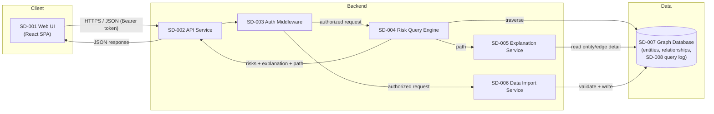
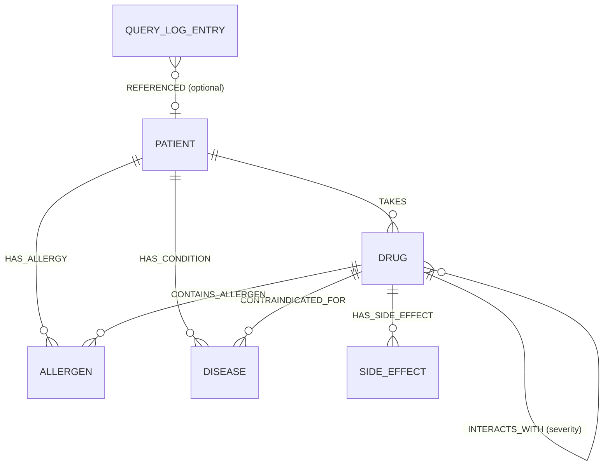
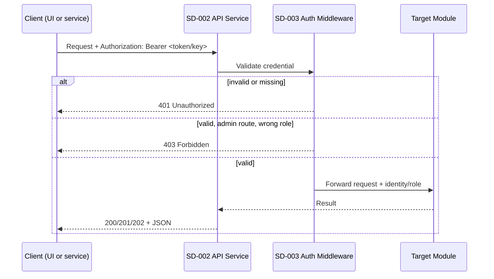

# System Architecture — Drug Interaction Safety Assistant

## 1. Architecture Diagram

Data flows in one direction per request: UI → API → Auth → the relevant service module → Graph Database, then the response retraces the same path back. No module other than SD-002 (API Service) is reachable directly from the client, and no module other than the service layer (SD-004/005/006) talks to SD-007 directly — the graph database has no client-facing surface of its own.

## 2. Modules / Components

| ID | Component | Responsibility | Boundary |
|----|-----------|-----------------|----------|
| SD-001 | Web UI (React SPA) | Renders all screens (SCR-001–008); calls the API for all data — never reads the graph database directly. | Owns presentation and client-side state; never decides whether a drug/allergy/condition combination *is* a risk (that's the backend, SD-004) — but does own a few pure, UI-adjacent domain rules that operate only on data already returned by a real endpoint: graph-element mapping + the node-label rule (V0.6), severity ordering (V0.7), export-report consistency (V0.11). None of these introduce new backend state. |
| SD-002 | API Service | Single HTTP entry point; request validation, routing, response shaping, OpenAPI contract. | Stateless; delegates every piece of business logic to SD-004/005/006 rather than implementing it inline. |
| SD-003 | Auth Middleware | Validates the bearer credential on every request, resolves identity + role. | Runs before any other backend module; a request that fails here never reaches SD-004/005/006. Exposes both `requireAuth` and a `requireAdmin` middleware (role-gate primitive) for any future admin-only route, though no route uses `requireAdmin` today — bulk import (SD-006) was admin-gated through V0.11 but that gate was removed in V0.12 so any authenticated user can import. |
| SD-004 | Risk Query Engine | Core traversal logic: drug–drug interaction lookup, allergy conflict check, contraindication check (REQ-007–009); incremental recheck (REQ-016) **implemented V0.7**; multi-hop exploration (REQ-017) still planned. **Implemented (V0.3–V0.4, extended V0.7)** as four cooperating modules, not one: `interactions`, `allergy-links`, and `contraindications` each own one relationship type's severity business rule and expose a `findXRisks(...)` use case; `risk-check` is the thin orchestrator that resolves a patient's profile once and composes the three `findXRisks` calls — this is the actual shape of "SD-004" in code, kept as one logical component here since they always act together. Incremental mode reuses `findAllergyRisks`/`findContraindicationRisks` unchanged (already scoped to just the new drug by construction) and adds one new query shape, `findInvolving`, to `interactions` specifically. | Reads the graph, never writes it (write paths are the modules' own `create*` use cases, e.g. `createInteraction`); returns risk results — does not itself produce natural-language text. |
| SD-005 | Explanation Service | Converts a relationship path into a natural-language explanation (REQ-011) and prepares the render-ready node/edge payload used by SCR-004. **Implemented (V0.5)** as the `explanations` module: builds a path itself from a risk-type module's own aggregate (`buildInteractionPath`/`buildAllergyPath`/`buildContraindicationPath`), generates text via `explainPath`, then verifies the result with `assertGroundedInPath` — a reference-tracking check (the generator records every node id it actually used; the assertion checks that set against the path's real nodes) rather than re-parsing the generated prose, which would be easy to fool. Generation approach: **template-based, resolved (not an LLM)** — see Technology Decision Log. | Builds its own path from data it's given by the risk-type modules (`findById` on each of `interactions`/`allergy-links`/`contraindications`), not from the graph directly; never asserts a relationship absent from that path (per the business rule in Requirements §3), enforced in code, not just by convention. |
| SD-006 | Data Import Service | Validates and loads bulk datasets (REQ-019): schema check, PII-pattern rejection (NFR-003), then write. Runs as the async job described in §7. **Implemented (V0.10)**, extended **V0.12** so a drug row's optional `interactsWith`/`containsAllergen`/`contraindicatedFor` columns bulk-create the matching relationship in the same pass (two-pass: drug/reference nodes first, then edges, reusing SD-004's own `create*` use cases) — only the `drug` entity type has a parser/validator; `ImportEntityType` stays an open union for future types. | Only backend module with graph *write* access for bulk operations; open to any authenticated user (`requireAuth` only) — admin-gating (`requireAdmin`) was removed in V0.12 so a normal user can bulk-load their own catalog data. |
| SD-007 | Graph Database | Primary datastore for every entity and relationship in §3, plus SD-008 query-log entries. | No direct client access; all reads/writes go through SD-004/005/006. Concrete engine: **Neo4j 5.24 Community Edition** — resolved via spike, Build Plan V0.1 (see §6). |
| SD-008 | Query History Log | Logical record, persisted inside SD-007, of each query's input and result (REQ-018) for SCR-007. **Implemented (V0.9)** as the `query-log` module. | Written by SD-002 (`risk-check` routes) after every `risk-check`/`risk-check/incremental` call completes, success or failure — as a best-effort side effect that swallows its own failures rather than ever breaking the risk-check response; not yet wired to `explore` since that's still unbuilt (V0.8). Read-only from the UI's perspective: no create endpoint is exposed to clients. |

## 3. Database Schema

The graph database uses a labeled-property-graph model: typed nodes with properties, typed relationships (edges) that may themselves carry properties (e.g., interaction severity). This shape is independent of the specific engine chosen in the pending spike (§6).

### Node types

Field names use camelCase, matching the TypeScript codebase on both sides of the API boundary (see CLAUDE.md §1).

| Entity | Field | Type | Notes |
|--------|-------|------|-------|
| **Drug** | `id` | UUID | Primary key |
| | `name` | string | Brand/common name |
| | `genericName` | string | |
| | `drugClass` | string | e.g., "ACE inhibitor" |
| | `dosageForm` | string | e.g., "tablet", "injection" |
| | `deletedAt` | datetime, nullable *(added REQ-027)* | Soft-delete marker; absent/null = active. Node and all its edges are never removed — only excluded from active list/catalog queries. |
| **Patient** | `id` | UUID | Primary key |
| | `displayName` | string | Synthetic only (Constraint: no real PII, NFR-003) |
| | `createdAt` | datetime | |
| | `deletedAt` | datetime, nullable *(added REQ-027)* | Soft-delete marker; absent/null = active. `findById` stays unfiltered so historical query-log lookups keep resolving. |
| **Disease** | `id` | UUID | Primary key |
| | `name` | string | Condition/diagnosis name |
| | `icdCode` | string, nullable | Optional reference code |
| **Allergen** | `id` | UUID | Primary key |
| | `name` | string | Ingredient/allergen name |
| **SideEffect** | `id` | UUID | Primary key |
| | `name` | string | |
| | `description` | string | |
| **QueryLogEntry** | `id` | UUID | Primary key |
| | `queryType` | enum(`patient_check`, `ad_hoc`, `multi_hop`, `incremental` *(added V0.9)*) | `incremental` distinguishes a V0.7 incremental recheck from a full `patient_check` — both real, distinct query shapes worth telling apart in a review/demo log |
| | `inputSummary` | JSON (stored as a JSON string property — Neo4j properties can't hold nested objects) | Drugs/patient/query params submitted |
| | `resultSummary` | JSON (stored as a JSON string property) | Risk counts by severity, plus (**extended V0.9**) the full original `risks` array on success — needed so SCR-007's "reopen read-only" can show the real original result without re-running the traversal; on failure, `status:"failed"` + `errorMessage`, zero risks |
| | `createdAt` | datetime | |
| **User** *(added in Build Plan V0.1)* | `id` | UUID | Primary key |
| | `username` | string | Unique — enforced by constraint |
| | `passwordHash` | string | bcrypt hash, never the plaintext password |
| | `role` | enum(`standard`, `admin`) | Distinguishes account type; no route currently gates on it (see §5) |
| **ImportJob** *(added in Build Plan V0.10)* | `id` | UUID | Primary key |
| | `entityType` | enum(`drug`) | Open union in code; only `drug` has an implemented parser |
| | `status` | enum(`queued`, `validating`, `importing`, `complete`, `failed`) | |
| | `acceptedCount` / `rejectedCount` | int | |
| | `errors` | JSON (stored as a JSON string property) | `{ rowNumber, reason }[]` — every rejected row's specific reason, never a silent drop |
| | `createdAt` / `updatedAt` | datetime | |

The `User` node wasn't in the original schema — §5's auth flow implied "a stored user record" without specifying its shape. It was added here once the walking skeleton actually needed real login, so this table stays the accurate source of truth. `ImportJob` is the same kind of addition, for SD-006's async job tracking (§7) — not in the original schema either, since bulk import wasn't designed down to the node level up front.

### Relationship types

| Relationship | From → To | Properties | Cardinality |
|--------------|-----------|------------|-------------|
| `TAKES` | Patient → Drug | — | many-to-many |
| `HAS_ALLERGY` | Patient → Allergen | — | many-to-many |
| `HAS_CONDITION` | Patient → Disease | — | many-to-many |
| `INTERACTS_WITH` | Drug → Drug | `id`, `severity` (enum: minor/moderate/severe/contraindicated) | many-to-many, symmetric |
| `CONTRAINDICATED_FOR` | Drug → Disease | `id`, `severity` (same enum) | many-to-many |
| `CONTAINS_ALLERGEN` | Drug → Allergen | `id`, `severity` (same enum) | many-to-many |
| `HAS_SIDE_EFFECT` | Drug → SideEffect | — | many-to-many |
| `REFERENCED` | QueryLogEntry → Patient | — | optional, zero-or-one (absent for ad-hoc queries) |

**Extended in Build Plan V0.4:** `CONTRAINDICATED_FOR` and `CONTAINS_ALLERGEN` originally had no properties. Both now carry `id` (for the same relationship-uniqueness constraint pattern as `INTERACTS_WITH`) and `severity`, applying the same business rule uniformly: an allergy conflict ranges from a mild rash to anaphylaxis, and a contraindication can be relative or absolute, so both need the same severity signal `INTERACTS_WITH` already required — a risk without a severity can't be sorted or filtered (REQ-015) or rendered with a severity badge (Design System §1) regardless of which relationship produced it.

Business-rule enforcement at the schema level (Requirements §3, extended in V0.4): `INTERACTS_WITH`, `CONTRAINDICATED_FOR`, and `CONTAINS_ALLERGEN` cannot be created without a `severity` value; `TAKES`/`HAS_ALLERGY`/`HAS_CONDITION` cannot reference a node that doesn't already exist (no implicit node creation on edge write) — and neither can `INTERACTS_WITH`/`CONTRAINDICATED_FOR`/`CONTAINS_ALLERGEN`, which likewise require both endpoint nodes to already exist.

## 4. API Design

All paths are prefixed `/api/v1`. All request/response bodies are JSON unless noted.

Field casing is camelCase throughout, matching the TypeScript codebase (CLAUDE.md §1) — corrected here from this table's original snake_case as each endpoint was actually built. Rows marked **(built)** exist in the running API as of Build Plan V0.4; the rest remain planned for later versions and may still change shape when built.

| Method | Path | Request shape | Response shape | Status codes | |
|--------|------|----------------|------------------|---------------|---|
| POST | `/auth/register` | `{ username, password }` | `{ username }` | 201, 400, 409 | **(built)** — added in V0.1, not in the original design |
| POST | `/auth/login` | `{ username, password }` | `{ token, expiresAt, role }` | 200, 400, 401 | **(built)** |
| GET | `/drugs` | — | `[{ id, name, genericName, drugClass, dosageForm }]` | 200, 401 | **(built)** — added in V0.1, not in the original design |
| POST | `/drugs` | `{ name, genericName, drugClass, dosageForm }` | `{ id, name, genericName, drugClass, dosageForm }` | 201, 400, 401 | **(built)** |
| PUT | `/drugs/{id}` | `{ name, genericName, drugClass, dosageForm }` (all required, unlike patient's partial `PUT`) | same shape as POST response | 200, 400, 401, 404 | **(built, V1.2)** |
| DELETE | `/drugs/{id}` | — | `{ id, name, genericName, drugClass, dosageForm, deletedAt }` | 200, 401, 404, 409 | planned (REQ-027) — 409 if already deleted |
| GET | `/drugs/deleted` | — | `[{ id, name, genericName, drugClass, dosageForm, deletedAt }]` | 200, 401 | planned (REQ-027) — registered before `/drugs/{id}` |
| GET / POST | `/allergens` | — / `{ name }` | `[{id,name}]` / `{id,name}` | 200/201, 400, 401 | **(built)** — added in V0.2, not in the original design |
| GET / POST | `/diseases` | — / `{ name, icdCode? }` | `[{id,name,icdCode?}]` / `{id,name,icdCode?}` | 200/201, 400, 401 | **(built)** — added in V0.2, not in the original design |
| GET | `/patients` | — | `[{ id, displayName, medicationCount }]` | 200, 401 | **(built)** — still no `lastCheckedAt`; query-log exists now (V0.9) and could derive it, but this endpoint wasn't revisited to add it |
| POST | `/patients` | `{ displayName, medicationIds, allergyIds, conditionIds }` | `{ id, displayName, medicationIds, allergyIds, conditionIds, createdAt }` | 201, 400, 401 | **(built)** |
| GET | `/patients/{id}` | — | same shape as POST response | 200, 401, 404 | **(built)** |
| PUT | `/patients/{id}` | `{ displayName?, medicationIds?, allergyIds?, conditionIds? }` (partial) | same shape as POST response | 200, 400, 401, 404 | **(built)** |
| DELETE | `/patients/{id}` | — | same shape as POST response (with `deletedAt` set) | 200, 401, 404, 409 | planned (REQ-027) — 409 if already deleted |
| GET | `/patients/deleted` | — | `[{ id, displayName, medicationCount, deletedAt }]` | 200, 401 | planned (REQ-027) — registered before `/patients/{id}` to avoid route collision |
| POST | `/interactions` | `{ drugAId, drugBId, severity }` | `{ id, drugA:{id,name}, drugB:{id,name}, severity }` | 201, 400, 401 | **(built)** — added in V0.3, not in the original design |
| POST | `/drug-allergens` | `{ drugId, allergenId, severity }` | `{ id, drug:{id,name}, allergen:{id,name}, severity }` | 201, 400, 401 | **(built)** — added in V0.4, not in the original design |
| POST | `/contraindications` | `{ drugId, diseaseId, severity }` | `{ id, drug:{id,name}, disease:{id,name}, severity }` | 201, 400, 401 | **(built)** — added in V0.4, not in the original design |
| POST | `/risk-check` | `{ patientId }` OR `{ medications: [drugId], allergies: [allergenId], conditions: [diseaseId] }` | `{ risks: [{ id, type, severity, drugsInvolved, summary }], checkedAt }` | 200, 400, 401, 404 | **(built)** — `type` is now `"interaction" \| "allergy" \| "contraindication"`, all three returned together |
| POST | `/risk-check/incremental` | `{ patientId, newDrugId }` | same risk shape as `/risk-check` | 200, 400, 401, 404 | **(built, V0.7)** — REQ-016; `newDrugId` must already be on the patient's profile (caller persists via `PUT /patients/:id` first); returns only risks introduced by that one drug |
| GET | `/risks/{riskId}` | — (optional query: `?patientId=`) | `{ id, type, severity, explanation, path: { nodes: [...], edges: [...] } }` | 200, 401, 404 | **(built)** — `patientId` is optional; when present it adds the Patient node to every risk type's path: `HAS_ALLERGY`/`HAS_CONDITION` for allergy/contraindication, or a `TAKES` edge to each interacting drug for interactions **(extended V1.2)** — so the graph view (SCR-004) always shows the patient's connection, not just the drug-to-drug/allergen/disease relationship in isolation |
| POST | `/explore` | `{ startEntityId, startEntityType, relationshipTypes: [...], maxHops }` | `{ matches: [{ path: { nodes, edges } }], relationalComparison: { queryText, estimatedJoins } }` | 200, 400, 401 | planned (V0.8) |
| GET | `/query-log` | — | `[{ id, queryType, patientId?, inputSummary, resultSummary, createdAt }]`, newest first | 200, 401 | **(built)** — no `?page=` pagination yet; fine at demo data scale |
| GET | `/query-log/{id}` | — | same shape as list item | 200, 401, 404 | **(built)** |
| POST | `/admin/import` | multipart file (field `file`) + `{ entityType }` | `{ jobId, status: "queued" }` | 202, 400, 401, 403 | **(built)** — only `entityType: "drug"` is accepted; anything else is `400` |
| GET | `/admin/import/{jobId}` | — | `{ jobId, status, acceptedCount, rejectedCount, errors: [{ rowNumber, reason }] }` | 200, 401, 403, 404 | **(built)** |
| GET | `/health` | — | `{ status: "ok", graphDb: "ok" \| "unreachable" }` | 200, 503 | **(built)** |

Error responses share one shape across every endpoint: `{ error: { code, message, details? } }` (see §7).

## 5. Auth Flow

1. **Credential acquisition.** Human users (doctors, pharmacists, clinical decision-support staff) authenticate interactively via `POST /auth/login` (username + password) and receive a short-lived JWT. Machine clients (healthcare IT/AI developer integrations) instead use a long-lived API key issued out of band by an admin and stored in the graph DB's key/role table — both credential types are presented identically to the API (step 2).
2. Every subsequent request carries the credential as `Authorization: Bearer <token-or-key>`.
3. SD-002 (API Service) hands every incoming request to SD-003 (Auth Middleware) before any route handler runs.
4. SD-003 validates the credential: JWT signature + expiry check for tokens, or a key lookup against SD-007's key/role table for API keys.
5. If invalid, expired, or missing: SD-003 short-circuits with `401 Unauthorized` — no other backend module is invoked.
6. If valid: SD-003 attaches the resolved identity and role (`standard` | `admin`) to the request context.
7. SD-002 routes to the target module. No route currently requires `role === admin` — `POST /admin/import`/`GET /admin/import/{job_id}` were admin-gated through V0.11 but that gate was removed in V0.12; the `requireAdmin` middleware still exists in SD-003 (`403 Forbidden` for an authenticated non-admin) for any future route that needs it.
8. The target module (SD-004/005/006) executes and returns its result; SD-002 passes it back to the client unchanged.

## 6. Technology Stack

| Capability | Technology & Version | Reason |
|------------|------------------------|--------|
| Frontend framework | React 18 + TypeScript 5 | Component model fits the screen inventory (SCR-001–008); TS shares types with the backend contract. |
| Frontend build tool | Vite 5 | Fast dev server/HMR, minimal config, standard pairing with React + TS. |
| Backend runtime/framework | Node.js 20 LTS + Express 4, TypeScript | One language across UI and API reduces context-switch cost for a small team; broad ecosystem of graph-DB client libraries. |
| Auth | `jsonwebtoken` (JWT) for human sessions + an API-key/role table in SD-007 for machine clients | Meets NFR-004 without building a full IAM system, appropriate for a demonstration project (Charter §5). |
| **Graph database engine** | **Neo4j 5.24 Community Edition** — decided via spike, Build Plan V0.1 | Spiked against the alternative candidates: connected via the official driver, applied a real uniqueness constraint, and did a live write/read round trip in Docker — all passed cleanly. An embedded, no-Docker alternative (`kuzu`) was also tried, but rejected: it's marked deprecated upstream and pulls in a transitive dependency (`node-tar` via `cmake-js`) with a critical-severity advisory. Full rationale in the Technology Decision Log. |
| Graph DB client driver | `neo4j-driver` (official, npm) ^5.24 | Follows directly from the engine choice above; maintained by Neo4j, matches the server version. |
| **Graph visualization library (frontend)** | **Cytoscape.js 3.34** — decided via spike, Build Plan V0.6 | `react-force-graph` eliminated on a real installability risk (git+ssh transitive dependency it doesn't even need); cytoscape and vis-network both blew the NFR-002 budget with default physics layouts (~1200ms/50 nodes) but comfortably cleared it (~90–250ms) once switched to a non-physics layout suited to this product's actual graphs (small relationship paths, not dense arbitrary ones). Cytoscape won on dependency footprint (6MB vs. 81MB) and fit for purpose. Full rationale in the Technology Decision Log. |
| Natural-language explanation generation | **Template-based string generation, no LLM** — resolved in Build Plan V0.5 | AI Architecture was explicitly skipped (judged not a genuine AI/ML pipeline): the input to every explanation is always a complete, already-known path with no retrieval uncertainty, so there's nothing for a model to add. A deterministic template can't hallucinate a fact outside the path — an LLM could, at real cost/latency for no accuracy benefit here. |
| API documentation | OpenAPI 3.1, generated from route definitions | Keeps the contract in §4 in sync with implementation; standard for a REST API consumed by external IT/dev teams (Charter target user). |
| Testing | Vitest (unit) + Playwright (E2E) | Matches the Vite toolchain; Playwright covers the journeys in the UX document end-to-end. |
| Deployment (demo scale) | Docker, single `docker-compose` (API + UI + graph DB) | Self-contained demo/decision-support deployment (Charter §5); no orchestration complexity needed since there's no real-time hospital integration in scope. |

## 7. Cross-Cutting Concerns

**Caching strategy**
- Reference data that changes rarely relative to query volume (drug list, side-effect list, allergen list — used by SCR-001/SCR-005 autocomplete) is cached in-process with a short TTL (5 min) to keep typeahead fast without hitting SD-007 on every keystroke.
- Risk-check results (`POST /risk-check`) are never cached — a patient's profile can change at any time (REQ-016 incremental recheck must reflect current data), so every check is a live traversal.
- Multi-hop exploration results (`POST /explore`) may be cached per exact query signature for a short TTL (60s), since research/demo users typically re-run and tweak the same query repeatedly within a session.

**Background job strategy**
- Bulk import (SD-006) is the only asynchronous operation: `POST /admin/import` enqueues a job and returns `202` with a `job_id` immediately; a worker validates and writes records while the client polls `GET /admin/import/{job_id}` for status (`queued` → `validating` → `importing` → `complete`/`failed`).
- Everything else (risk-check, explore, patient CRUD) is synchronous request/response, consistent with the p95 ≤ 2s target (NFR-001) at the data scale in NFR-005.
- The job runs as an in-process async worker at this scale — no external queue (e.g., Redis/RabbitMQ). This is a scale assumption, not a hard requirement; revisit if import volumes grow beyond what one process can handle in a reasonable time.

**Error-handling conventions**
- Every API error returns the same shape: `{ error: { code, message, details? } }` with the matching HTTP status: `400` validation, `401` unauthenticated, `403` unauthorized, `404` not found, `409` conflict (e.g., editing a profile mid-recheck), `500` unexpected.
- Business-rule violations (Requirements §3) — e.g., a profile referencing a nonexistent drug — return `400` with a machine-readable `code` (e.g., `DRUG_NOT_FOUND`) so SCR-005 can render the specific inline field error defined in the UX document, rather than a generic failure banner.
- SD-005 (Explanation Service) never emits a partial or fabricated explanation: if path data is incomplete, `GET /risks/{risk_id}` omits the `explanation` field and the UI falls back to the "path unavailable, retry" state defined for SCR-003 — enforcing the business rule that explanations may only assert relationships present in the path.
- Unhandled exceptions are logged server-side with a correlation ID that is also returned in the error response body, so a user-reported failure can be traced in logs without exposing internals to the client. **This was documented from the start but not actually implemented until the V1.0 hardening pass found the gap** — the global error handler now generates a real UUID per 500, logs it alongside the error, and returns it as `error.correlationId`; verified live against a genuine database outage.
