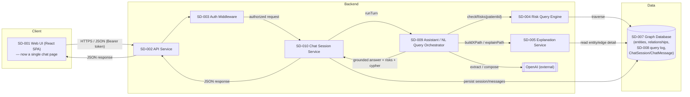
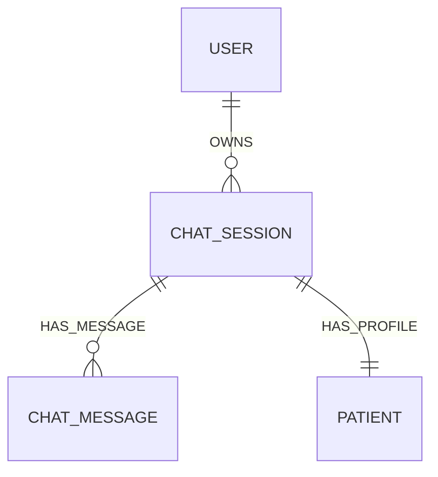

# System Architecture — Drug Interaction Safety Assistant (v2 — Conversational Assistant)

This document supersedes `docs/05-system-architecture.md` for the sections it changes (diagram, §3 schema, §4 API, §6 stack). SD-001–008 carry forward with the boundary notes below; SD-009/SD-010 are new. The original stays in place as the V1 historical record.

## 1. Architecture Diagram

Data still flows one direction per request: UI → API → Auth → Chat Session Service → the NL orchestrator (which composes the existing Risk Query Engine and Explanation Service, never bypassing them) → Graph Database, then back. The only new external dependency is OpenAI, reached exclusively from SD-009 — no other module calls it, and SD-009 never queries the graph directly itself (it composes SD-004/SD-005's own use cases, same "own your infrastructure" boundary as every other cross-module composition in this codebase).

## 2. Modules / Components

SD-001–008 carry forward from `docs/05-system-architecture.md` with these boundary notes:

- **SD-001 (Web UI)** — now a single conversational page. Screen inventory SCR-001/002/003/005/007/008/009 (`docs/03-ux-product-design.md`) are superseded by the new SCR ids in `docs/v2-conversational-assistant/03-ux-product-design.md`.
- **SD-004 (Risk Query Engine)** and **SD-005 (Explanation Service)** are unchanged in every respect — same traversal logic, same `assertGroundedInPath` grounding proof. SD-009 is a new *caller* of both, not a replacement for either.
- **SD-006 (Data Import Service)** — its HTTP surface (`POST /admin/import`) stays mounted but is no longer reachable from any screen; the new `apps/api/src/db/seed.ts` script reuses its validation logic directly (not via HTTP) to auto-populate the catalog on server boot.
- **SD-008 (Query History Log)** — unchanged; `QueryType` gains a `"chat"` value, written by SD-009's orchestration the same way `risk-check` routes write it today.

New components:

| ID | Component | Responsibility | Boundary |
|----|-----------|-----------------|----------|
| SD-009 | Assistant / NL Query Orchestrator | Extracts entities/intent from free text via an LLM (OpenAI), resolves names against the real catalog, invokes SD-004 (`checkRisks`) and SD-005 (`buildXPath`/`explainPath`/`assertGroundedInPath`) exactly as they exist today, attaches deterministic precaution tips, and asks the LLM to compose a natural-language answer strictly from that grounded fact set. Also serves the quick-check path (explicit ids, no extraction step). | The only module that calls OpenAI. Never queries the graph directly — always through SD-004/SD-005's own use cases (cross-module composition, same precedent as SD-004 itself composing `interactions`/`allergy-links`/`contraindications`). The LLM's `composeAnswer` call receives only the grounded fact set, never raw catalog/graph access — this is what keeps REQ-011/REQ-029's grounding guarantee true with an LLM in the loop. |
| SD-010 | Chat Session Service | Owns `ChatSession`/`ChatMessage` persistence and per-user ownership; provisions each new session's backing `Patient` record via SD-004's own `patients` use cases; calls SD-009 to actually answer a turn, then persists both sides. | Only module with write access to `ChatSession`/`ChatMessage`. Ownership check (`assertOwnedBy`) runs before any session read/write, same "runs before the target module" precedent as SD-003's auth check. |

## 3. Database Schema

Extends `docs/05-system-architecture.md` §3 — everything there (Drug, Patient, Disease, Allergen, SideEffect, QueryLogEntry, User, ImportJob, and all their relationships) is unchanged. New additions only:

### New node types

| Entity | Field | Type | Notes |
|--------|-------|------|-------|
| **ChatSession** | `id` | UUID | Primary key |
| | `userId` | UUID | Owning user's id |
| | `patientId` | UUID | The 1:1 backing `Patient` node's id (REQ-032/see Core Design Decision) |
| | `title` | string | Deterministic truncation of the first user message; not LLM-generated in this version |
| | `intakeComplete` | boolean *(added V2.0.3.3)* | False until the medications/allergies/conditions gathering (REQ-035) has genuinely finished for this session (full answer or retry cap); set true by SD-010 on SD-009's signal — see Intake-gate addendum below. |
| | `intakeAskCount` | int *(added V2.0.3.4)* | How many times the intake question has been asked so far (0, 1, or 2 — capped at `MAX_INTAKE_ASKS`); lets SD-009 tell a first ask apart from a retry and know when to give up. |
| | `createdAt` / `updatedAt` | datetime | |
| **ChatMessage** | `id` | UUID | Primary key |
| | `sessionId` | UUID | Owning session's id |
| | `role` | enum(`user`, `assistant`) | |
| | `text` | string | The message text (user's raw input, or the LLM-composed answer) |
| | `risks` | JSON (stored as a JSON string property) | Present on assistant messages — the grounded `Risk[]` for this turn, same shape as `RiskCheckResponse.risks` |
| | `cypherQueries` | JSON (stored as a JSON string property) | `{label, query}[]` — the literal query template(s) actually used this turn (REQ-030) |
| | `tips` | JSON (stored as a JSON string property) | Precaution strings attached to this turn's risks |
| | `unresolvedNames` | JSON (stored as a JSON string property) | Entity names the user mentioned that didn't resolve against the catalog |
| | `createdAt` | datetime | |

**Extends `Disease`** (optional, only for REQ-034 if built): `bodyRegion` — string, nullable, seeded value (e.g. `"kidneys"`, `"liver"`, `"skin"`), never user-entered.

### New relationship types

| Relationship | From → To | Properties | Cardinality |
|--------------|-----------|------------|-------------|
| `OWNS` | User → ChatSession | — | one-to-many |
| `HAS_MESSAGE` | ChatSession → ChatMessage | — | one-to-many |
| `HAS_PROFILE` | ChatSession → Patient | — | one-to-one |

Business-rule enforcement at the schema level: `ChatSession.id` and `ChatMessage.id` get the same `IS UNIQUE` constraint pattern as every other entity (see `apps/api/src/db/migrate.ts`). A `ChatSession` is a leaf entity — nothing else references it, so unlike `Patient`/`Drug` it can be hard-deleted (REQ-033) without the soft-delete machinery REQ-027 required.

### `INTERACTS_WITH` extension (demo-data enrichment addendum, built at the user's explicit request)

`INTERACTS_WITH` (Drug → Drug, defined in `docs/05-system-architecture.md` §3) gains two new optional properties, following the exact same precedent as V0.4's severity extension:

| Property | Type | Notes |
|----------|------|-------|
| `riskDescription` | string, nullable | The specific physiological risk of this pair (e.g. "raises the chance of serious bleeding"), authored in `demo-data/drug-import-demo.csv`'s new `risks` column. |
| `tip` | string, nullable | A practical mitigation tip for this pair, authored in the same CSV's new `tips` column. |

Both are optional — an interaction created without them (e.g. via the plain `POST /interactions` endpoint) simply omits them, and SD-009's assistant module falls back to the generic severity/type-keyed precaution templates (`assistant/domain/safetyTips.ts`) when they're absent. When present, they're surfaced verbatim in the chat's grounded fact set — still fully grounded, since they're data stored on the interaction edge itself, never something the LLM introduces.

**Idempotency fix required alongside this:** `Neo4jInteractionRepository.create` changed from a bare `CREATE` to an undirected `MERGE` on the drug pair (same precedent as `neo4jDrugImportRepository.ts`'s MERGE-by-name) — re-running the CSV import (to pick up the new `risks`/`tips` columns for pairs that already existed from an earlier import) now updates the existing edge instead of creating a duplicate. `severity` is always overwritten; `riskDescription`/`tip` use `coalesce` so a caller that doesn't supply them never wipes out data a previous import attached to that pair.

### Intake-gate addendum (REQ-035, built at the user's explicit request, V2.0.3.2 through V2.0.3.5)

Four rounds of live testing converged on: SD-009 needs to *gather* before it *concludes*, "gather" means retrying for what a reply left unanswered, and judging "answered" per category requires more care than a single free-form field can reliably give an LLM. The final design: the first time a session's user says anything substantive (names an entity, reports a symptom, or denies a category), SD-009 returns a deterministic intake question covering whichever of medications/allergies/conditions aren't yet **answered** — a category counts as answered once it has a known entry, or the user explicitly denied it. If a reply only addresses part of what was asked, SD-009 re-asks, naming only the still-missing categories, up to `MAX_INTAKE_ASKS` (2) total before giving up and concluding regardless. `ChatSession` tracks this via two properties (§3): `intakeComplete` (terminal) and `intakeAskCount` (how many times asked so far). Both are passed *into* `runTurn` by SD-010 on every call, read-only — SD-009 has no `ChatSession` access, same one-way dependency as everywhere else in this design — and SD-009 signals back via `TurnResult.intakeAskCount` (still gathering, persist this count) or `TurnResult.intakeJustCompleted` (done — either fully answered or the retry cap was hit; persist `intakeComplete = true`). Every turn once intake has concluded proceeds straight to a real risk-check against the accumulated profile.

A symptom report specifically is never resolved against the Disease catalog (a symptom like "nose bleeding" is not a diagnosed condition); `LlmPort.extractEntities` distinguishes `symptoms` from `conditions` for this reason, and receives up to the last 10 messages of real conversation history for context on short replies.

**V2.0.3.5 — denial detection redesigned as three independent booleans, not one array (a real LLM-reliability finding, not a code bug):** the original `ExtractedEntities.confirmedNone: string[]` design — one combined field the model populates holistically — reliably over-generalized in live testing: given "I have a penicillin allergy" after being asked about both allergies and conditions, `gpt-4o-mini` repeatedly returned `confirmedNone: ["conditions"]` even though conditions was never mentioned, apparently reasoning "the user replied, so the question is answered" rather than checking each category's own negation independently. Tightening the prompt with explicit counter-examples did not fix it — verified directly against the live OpenAI API with a standalone diagnostic script before touching the real prompt further. Restructuring to three separate fields (`medicationsDenied`/`allergiesDenied`/`conditionsDenied`), each requiring its own explicit true/false judgment, reliably eliminated the cross-contamination across a range of tested phrasings (positive-only answers, bare "no"/"none" replies, mixed positive-and-negative messages). Worth remembering as a general pattern for future LLM-judgment fields in this codebase: a single combined-judgment field a model fills holistically is a real failure mode independent of prompt quality — prefer one independent field per judgment when the categories must not influence each other.

### Conversation memory + general chat addendum (REQ-036/037, built at the user's explicit request, V2.0.3.6)

The session-history plumbing this relies on was already fully built (V2.0.3.2's `HISTORY_TURNS_FOR_CONTEXT` fetch in `chat-sessions`, threaded through to `runTurn`) — `extractEntities` already consumed it (to interpret short replies in context), but `composeAnswer` never did, so the assistant's own phrasing had no memory of what it had already said even though the underlying accumulated-profile facts persisted correctly. `LlmPort.composeAnswer` now also receives `history`, with one explicit prompt guardrail: prior turns (including the assistant's own earlier prose) are for tone/continuity only, never a new source of risk/interaction facts — every such claim still comes only from that turn's own `groundedRisks`, recomputed fresh via `checkRisks` every time. This is what keeps REQ-011/029's grounding guarantee true with history now in the prompt.

A new `LlmPort.composeGeneralAnswer` handles the two spots in `runTurn` that previously returned a hardcoded "I didn't catch any medications..." string whenever extraction found nothing substantive (a greeting, small talk, a general question) — replacing only that specific fallback arm in each location; the symptom-template and unresolved-name messages, the intake gate's own re-ask logic, and the risk-conclusion path are all unchanged. Its prompt permits general (non-personalized) health/pharmacology knowledge but explicitly forbids asserting any conclusion about the user's own risk — a message that sounds personalized gets redirected to naming specific medications/allergies/conditions rather than a guess, keeping REQ-022 ("no clinical diagnosis") intact even for content the risk-check pipeline never touches.

## 4. API Design

All paths still prefixed `/api/v1`. Everything in `docs/05-system-architecture.md` §4 stays mounted (marked below where it's no longer UI-driven). New routes:

| Method | Path | Request shape | Response shape | Status codes | |
|--------|------|----------------|------------------|---------------|---|
| POST | `/chat-sessions` | — | `{ id, title, createdAt }` | 201, 401 | Provisions the backing `Patient` internally |
| GET | `/chat-sessions` | — | `[{ id, title, createdAt, updatedAt }]`, newest first | 200, 401 | Sidebar list, current user's sessions only |
| GET | `/chat-sessions/{id}` | — | `{ id, title, createdAt, messages: [ChatMessage] }` | 200, 401, 403, 404 | 403 if the session isn't owned by the caller |
| POST | `/chat-sessions/{id}/messages` | `{ text }` | `{ userMessage: ChatMessage, assistantMessage: ChatMessage }` | 200, 400, 401, 403, 404 | The core turn endpoint — free-text path (REQ-028/029) |
| POST | `/chat-sessions/{id}/quick-check` | `{ medicationIds, allergyIds, conditionIds }` | same shape as `/messages` | 200, 400, 401, 403, 404 | Bypasses extraction (REQ-031) |
| DELETE | `/chat-sessions/{id}` | — | `{ id, deletedAt }` (hard delete — no soft-delete state) | 200, 401, 403, 404 | REQ-033 |
| PATCH | `/chat-sessions/{id}/pin` | `{ pinned }` | `{ id, pinned }` | 200, 401, 403, 404 | Toggles the "Pinned" section of the sidebar |

**No longer UI-driven, kept mounted (harmless, authenticated, no screen calls them):** `GET/POST/PUT/DELETE /patients`, `GET /patients/deleted`, `GET/POST /query-log`... i.e. `GET /query-log`, `GET /query-log/{id}`, `POST /admin/import`, `GET /admin/import/{jobId}`. Still used internally: `patients`' use cases (called directly by SD-010, not via HTTP), `risk-check`'s `checkRisks` (called directly by SD-009), `GET /drugs`/`GET /allergens`/`GET /diseases` (the quick-check popup's typeahead).

## 5. Auth Flow

Unchanged from `docs/05-system-architecture.md` §5 — every new route above goes through SD-003 (`requireAuth`) first, identical to every existing route. `ChatSession` ownership (`req.user.id === session.userId`) is a second, session-specific check inside SD-010, analogous to how `requireAdmin` is a second check layered after `requireAuth`.

## 6. Technology Stack

Extends `docs/05-system-architecture.md` §6. All existing rows unchanged. New row:

| Capability | Technology & Version | Reason |
|------------|------------------------|--------|
| Natural-language entity extraction + answer composition | **OpenAI API** (`openai` npm package) | Reverses the V0.5 "template-based, no LLM" decision — see `docs/07-technology-decision-log.md` for the explicit rationale. Confined to SD-009 only; every risk/severity/path fact still comes from the unchanged, deterministic SD-004/SD-005 pipeline — the LLM extracts and rephrases, it never originates a clinical fact. |

## 7. Cross-Cutting Concerns

Extends `docs/05-system-architecture.md` §7. New notes:

- **LLM failure handling** (NFR-007): an OpenAI extraction/composition failure or timeout returns a clear, non-500 "couldn't process that, try rephrasing" assistant message — never a raw error, never a silently-wrong risk-check based on a failed extraction.
- **Background job strategy**: the server-boot auto-seed (`apps/api/src/db/seed.ts`, run from `server.ts` when the `Drug` catalog is empty) is a new one-time-per-empty-database async step, same "no external queue, in-process" scale assumption as SD-006's bulk import worker.
